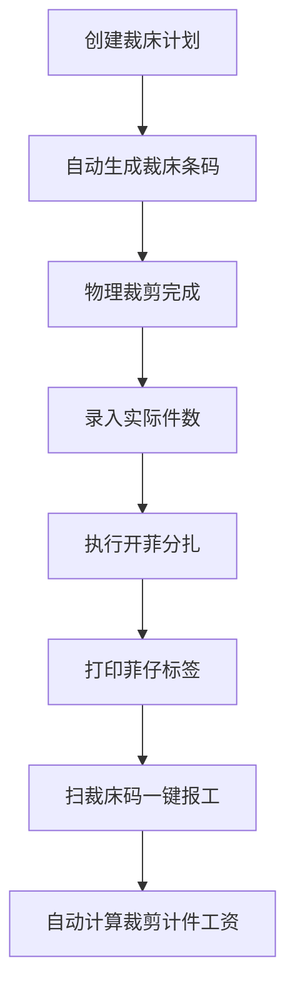

# 裁床开菲功能设计合理性深度分析报告

本报告针对 [制衣厂ERP系统-完整需求文档.md](../full-requirements.md) 中 **模块3：裁床与开菲** 的设计进行深入分析。结合服装制造行业（Garment Manufacturing）的实际车间业务场景、数字化管理痛点以及系统可扩展性，评估现有设计的合理性，并提出优化与改进方案。

---

## 1. 核心业务流程评估

### 1.1 现有设计流程梳理
根据需求文档，目前裁床开菲的流转逻辑如下：


### 1.2 合理性与亮点
- **一扎一菲（捆扎流转）**：以「扎（Bundle）」为基本流转单位符合服装厂车间流水线的典型特征，能有效防止混款、混色、混码（防止色差和尺码错乱）。
- **整床快速报工**：裁剪作为首道工序，通过扫一次裁床码完成整床所有扎号的裁剪报工，极大简化了裁床师傅的移动端操作，避免了逐扎扫码的繁琐。
- **状态联动**：开菲后订单自动变更为「生产中」，状态流转逻辑清晰。

---

## 2. 实际车间场景下的关键设计缺陷与风险

虽然现有设计能跑通基本闭环，但在面对真实制衣厂的复杂生产环境时，存在以下**严重的合理性缺陷**和**业务漏洞**：

### 🔴 缺陷一：单色单码计划与物理“铺料拉布”的严重脱节
* **文档现状**：在 [3.1 新增裁床计划弹窗](../full-requirements.md#L604-L615) 中，每个裁床计划必须绑定**单一颜色**和**单一尺码**。
* **实际场景**：制衣厂裁床的物理核心是“拉布（Spreading）”和“排料画样（Marker Making）”。为了节省面料，裁剪师傅会在同一张裁床上堆叠数十层面料（铺料），并使用一张包含**多个尺码**（如 S、M、L 各几件）的排料图进行一次性裁剪。
* **业务痛点**：
  * 如果按照现有设计，若一床布里有 S、M、L 三个尺码，录入员必须在后台新建 **3 个独立的裁床计划**，生成 **3 个不同的裁床条形码**。
  * 裁床师傅剪完这一床后，必须扫 **3 次**不同的条码才能完成报工。这完全违背了车间“一床一次裁剪”的物理事实，极大地增加了文员的录入工作量和工人的操作成本。
* **解决方案**：重构裁床计划，支持 **“一床多色多码”的矩阵结构**（详见第 3 节方案）。

---

### 🔴 缺陷二：条码/二维码载荷设计不合理，导致车间扫码高失败率
* **文档现状**：
  * [3.2 裁床条形码内容](../full-requirements.md#L641-L652) 编码了完整的 JSON 字符串（含 `orderId`、`styleCode`、`color`、`size` 等，共约 100+ 字符）。
  * [3.5 扎号QR码内容](../full-requirements.md#L771-L782) 也使用了包含多字段的 JSON 字符串。
* **实际场景**：
  * 车间使用的菲仔标签尺寸通常较小（如 60mm×40mm），在一张标签上并排打印一个 1D 条形码和一个 2D 二维码，留给每个码的物理空间极小。
  * 车间环境多粉尘、光线差，且工人使用的是低端手机进行小程序扫码，打印机也是普通的 203 DPI 热敏条码机。
* **技术瓶颈**：
  * **1D 条形码（如 Code128）的字符长度与密度成正比**。将 100+ 字符的 JSON 存入条形码，会导致条码极度密集，普通扫码枪 and 手机摄像头在 60mm 宽的标签上**根本无法识别**。
  * JSON 字符串包含中文（如 `"color": "红色"`），在不同的设备编码集下极易产生**乱码**，导致扫码解析失败。
* **解决方案**：
  * 抛弃 JSON 编码方案。使用**短全局唯一标识符（GUID / Unique ID）**。
  * 例如：裁床条码只编码 `C20260605001`（裁床单 ID），扎号二维码只编码 `B2026060500045`（扎 ID）。扫码后由手机端向服务器发起 HTTP 请求获取详细 JSON 信息。

---

### 🟡 缺陷三：裁剪工序“独占计件”与多人协作的冲突
* **文档现状**：[3.2 报工流程](../full-requirements.md#L659-L666) 规定：扫裁床码的登录用户自动完成该床裁剪工序，计件工资归属于该人。
* **实际场景**：在稍有规模的服装厂，裁床是一个**多人协同小组**。通常有：
  1. 拉布工（负责搬运、铺平布料，体力消耗大）
  2. 裁剪工（负责使用电剪或电脑裁床裁剪，技术要求高）
  3. 菲仔工/分扎工（负责分扎、贴菲仔、核对数量）
* **业务痛点**：如果仅由扫码的人独占该床的全部裁剪工资，会导致小组成员利益分配不公，或者需要在系统外手动记账分钱，使系统的计件工资模块失去意义。
* **解决方案**：在录入实际数或开菲时，支持指定**多名协作工人**并按比例或工种（拉布、裁剪、分扎）分摊该床的裁剪工资。

---

### 🟡 缺陷四：缺乏“裁片损耗与补片（Recutting）”的管理闭环
* **实际场景**：在车间缝纫（车缝）过程中，经常因为各种原因（布料抽纱、工人车坏、沾染污渍）导致裁片报废。此时车缝工人必须拿坏片去裁床“补片”（重新裁剪单片面料来替换）。
* **系统漏洞**：现有需求中完全没有“补片”流程。
  * 如果裁床师傅直接剪布补片，使用的面料没有出库记录，会导致**面料库存对不上**。
  * 补片原因没有记录，无法统计**损耗率和责任人**（是裁床剪错，还是车缝车坏？）。
  * 缺少补片打印（补片菲），车缝后续扫码报工可能出现数量缺失或条码混乱。
* **解决方案**：在移动端或后台增加“补片申请”与“补片打印”流程。

---

### 🟡 缺陷五：尾扎分扎规则缺乏灵活性
* **文档现状**：[3.4 分扎逻辑](../full-requirements.md#L699-L733) 规定，尾扎不足一扎时单独成扎（即使只有 1 件也单独成扎）。
* **实际场景**：如果一扎的标准件数是 20 件，实际裁出 81 件。按照系统逻辑会分成：`20, 20, 20, 20, 1` 共 5 扎。
* **业务痛点**：最后一扎只有 1 件时，单独为它打印一张菲仔并在后续几十道工序中让每个工人单独扫码，会造成极大的工时浪费和标签纸张浪费。车间通常的做法是**将极小的尾扎合并到上一扎**（如分成 `20, 20, 20, 22` 共 4 扎）。
* **解决方案**：支持“尾扎合并阈值”配置。例如：当尾扎数量小于等于标准每扎件数的 15%（或手动指定件数，如 $\le 3$ 件）时，自动合并到上一扎。

---

### 🔴 缺陷六：忽略了面料（物料）与裁剪部位（裁片）的物理隔离
* **文档现状**：原有的裁床计划与菲仔设计中，完全未指定裁剪所消耗的**面料**以及所产出的**部位**（裁片部件）。
* **实际场景**：
  * **面料区分**：服装存在主面料（Shell）、里料（Lining）、配料（Contrast）等多种面料，它们是在不同的铺料案台上单独排料裁剪的。如果不作区分，系统将无法精准扣减对应面料的BOM物料用量，也无法产生对应的“里布菲”、“主料菲”。
  * **部位区分**：对于复杂的预制工序（如袖子、口袋单独加工），大厂往往需要分部位开菲流转。若不显示部位，工人拿到大扎裁片后难以肉眼甄别分类。
* **解决方案**：裁床计划单增加必填的「裁剪面料」和选填的「裁剪部位」，并同步印在菲仔纸面文字上。

---

## 3. 功能改进设计方案建议

为了使 ERP 系统的裁床开菲模块更符合制衣厂的真实生产运作，建议在开发前对需求文档进行以下调整：

### 3.1 方案一：重构“裁床计划”为矩阵式一床多码
建议将 [3.1 裁床计划](../full-requirements.md#L568-L633) 改造为支持单床多色多尺码录入：

#### 裁床计划单表结构优化
* 一个裁床计划单包含一个主表和两个从表：
  * **主表**：裁床单号、床次、排料图（图片附件）、实际铺料层数、拉布人、裁剪人、状态。
  * **配比从表（Marker Ratio）**：记录该床排料图的配比（如 M码: 2件, L码: 2件, XL码: 1件）。
  * **明细从表（Qty Detail）**：由 `层数 × 配比` 自动计算并允许微调的各色各码计划数与实际数。

```
【第 2 床 裁床计划】
拉布层数：50 层
├─ 颜色：黑色
│  ├─ M 码：配比 2  -> 计划件数 100 -> 实际录入 102 (开菲: 5扎)
│  └─ L 码：配比 1  -> 计划件数 50  -> 实际录入 49  (开菲: 3扎)
└─ 颜色：白色
   └─ L 码：配比 1  -> 计划件数 50  -> 实际录入 51  (开菲: 3扎)
```
这样，**一床只需生成一个裁床条形码**（代表物理上的这一整床裁减），扫码后系统自动将该床下属的黑色 M 码、L 码及白色 L 码的所有扎号的裁剪工序全部标记为完成，并按录入的物理层数 and 人员配置分摊裁剪工资。

---

### 3.2 方案二：极简条码/二维码结构（微型化标签）
建议修改 [3.2 裁床条形码](../full-requirements.md#L636-L652) 和 [3.5 扎号QR码](../full-requirements.md#L771-L782) 的数据结构：

| 码类型 | 现行设计（JSON） | 推荐设计（全局短ID） | 优势 |
| :--- | :--- | :--- | :--- |
| **裁床条形码** | `{"type":"cutting","orderId":"ORD20240101001",...}` | `C20260605001` (C + 年月日 + 3位流水) | 长度降至 12 字符，条码极大稀疏化，203DPI 可完美清晰打印，100% 扫码成功率。 |
| **扎号QR码** | `{"orderId":"ORD20240101001","styleCode":...}` | `B2026060500045` (B + 年月日 + 5位流水) | 降低二维码矩阵复杂度，提高强反光或污损情况下的纠错与扫码速度。 |

---

### 3.3 方案三：引入“裁床状态锁”机制以防数据冲突
* **设计规则**：
  * **未开菲**：可自由编辑实际件数、配比、每扎件数，可删除计划。
  * **已开菲但未开始缝纫**：允许“撤销开菲”以退回编辑状态。撤销时，系统作废已生成的扎号。
  * **已开菲且已开始缝纫（即有任意一个扎号被后续车缝工人扫码报工）**：**系统强制锁定**该裁床计划。此时禁止删除、禁止修改实际数、禁止重新分扎。如果数量有变，必须通过“补片/扣减”等异常调整功能解决。

---

### 3.4 方案四：补片与换片管理流程（异常闭环）
新增一个轻量级的补片申请与打印流程：
1. **申请**：车缝工人在小程序端发现裁片损坏，点击“申请补片”，选择当前扫码的扎号、坏片工序、部位（如前幅、袖子），并输入数量。
2. **审批**：组长在后台/小程序管理端确认（防止工人无节制补片隐瞒失误）。
3. **打印补片菲**：裁床打印机打印出一张特制的“补片菲仔”，包含补片条码（标记为补片类型）。
4. **裁剪与领用**：裁床师傅凭补片菲剪料，将新裁片和补片菲发给工人。
5. **追溯**：财务/质检报表中增加“补片损耗率分析”，作为面料损耗与工人绩效考核的重要依据。

---

### 3.5 方案五：灵活的尾扎合并规则配置
In [3.4 自动分扎](../full-requirements.md#L699-L733) 的逻辑中，增加一个参数：`尾扎合并阈值（Merge Threshold）`。
- **计算逻辑**：
  * 设标准每扎件数为 $S$，最后一扎剩余件数为 $R$。
  * 如果 $R \le \text{Threshold}$（例如阈值设为 3 件，或者标准件数的 15%）：
    * 不生成最后一扎，而是将 $R$ 件均匀分配或直接加到前几扎中。
  * **示例**：实际件数 82，标准每扎 20，阈值设为 3。正常分扎：$20, 20, 20, 20, 2$ （5扎，尾扎 2 件 $\le 3$）; 触发阈值合并：$20, 20, 20, 22$ （4扎，尾扎 2 合并到最后一扎）。

---

### 3.6 方案六：裁床计划中引入【裁剪面料】与【裁剪部位】
为了精准控制物理流转并为BOM扣料和车间工人配片提供依据：
1. **新增面料关联**：创建裁床计划时，自动拉取该订单配料表（BOM）中的原料列表，必须选择本次裁剪的【面料名称】（如主料、里布等）。
2. **新增部位字段**：新增可手输/下拉选择的【裁剪部位】字段（例如：全套、身子、袖子、领子等），默认“全套”。
3. **标签增强**：打印的菲仔纸面上清晰印出对应的“面料：XXXX”和“部位：XXXX”文本字样，工人扫码后可在手机端一目了然看到本扎包含的材质和部件。

---

## 4. 总结

[制衣厂ERP系统-完整需求文档.md](../full-requirements.md) 中原有的“裁床开菲”设计建立在一种理想化的、单件流的假设下。在实际的服装制造车间中，**一床多尺码裁剪、低精度条码打印扫码、多人合作裁剪以及频繁的裁片破损补片**是无法回避的核心问题。

通过引入**矩阵式裁床计划**、**极简短 ID 编码**、**状态锁控制**、**补片流程**以及**尾扎合并规则**，可以显著提升系统的专业度，降低车间工人的操作抗拒感，确保项目上线后的稳定运行与数据真实性。
